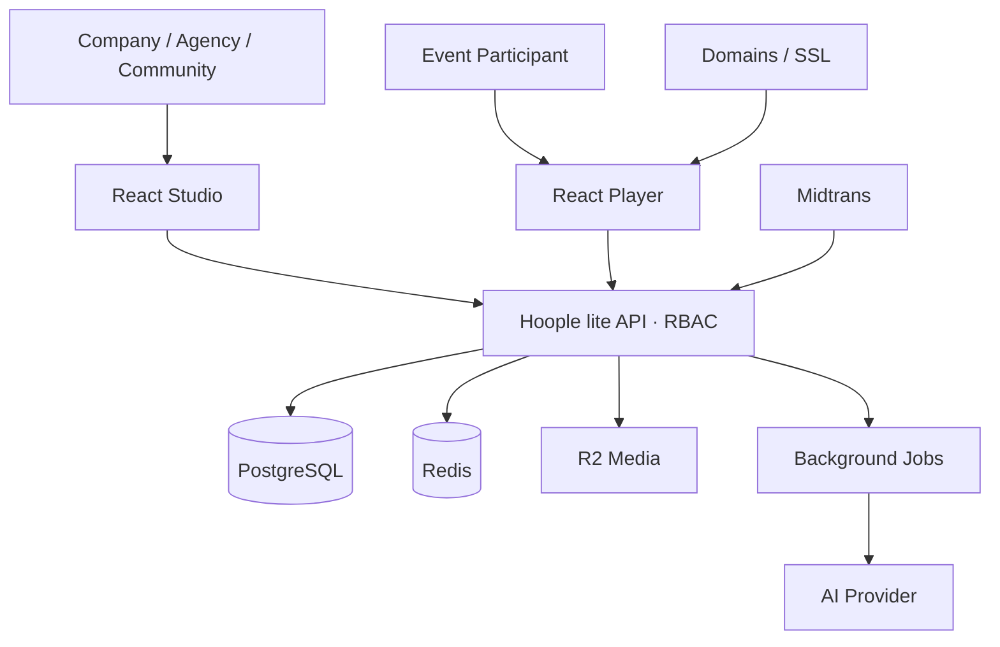
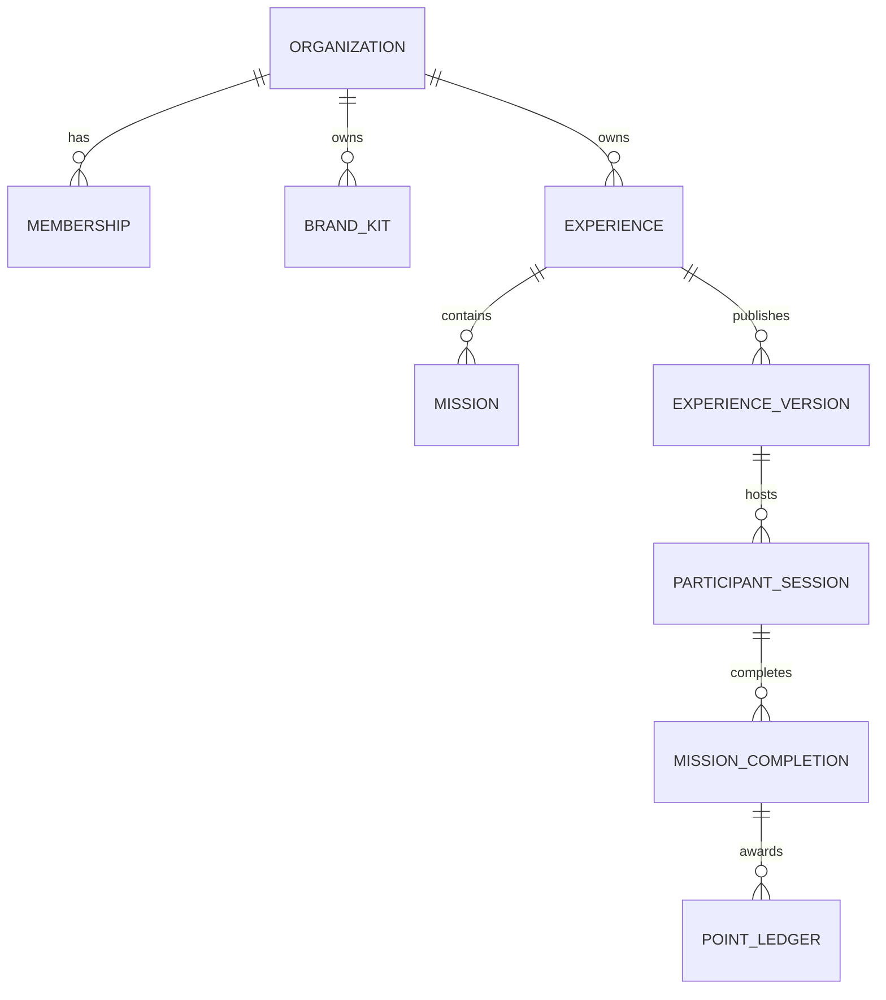
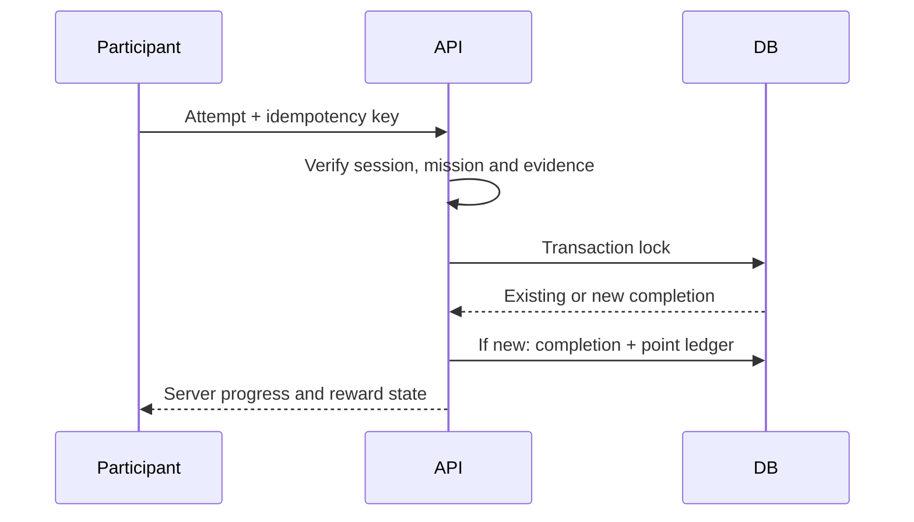

# Hoople lite — Experience Backend Architecture Blueprint

Status: **DESIGN / P0 FOUNDATION PARTIALLY IMPLEMENTED** · 2 November 2026 · React v0.9 / API v0.1

Target: multi-tenant SaaS for Indonesian EO, agencies, brands, companies and communities. The current React Sites demo uses local browser state and is **not** a secure production runtime.

P0 code is now available at `apps/api`: Fastify/TypeScript liveness/readiness, PostgreSQL migration for `users`, `organizations`, `memberships`, and `audit_logs` with forced RLS, plus transaction-scoped org context. No authentication, CRUD/event API, real DB provisioning, or frontend integration exists yet.

## 1. Proposed technology

| Layer | Recommendation | Reason |
| --- | --- | --- |
| Studio and player | Existing React/Vite, CDN | Keep bilingual responsive UI |
| API | TypeScript Fastify modular monolith | Quick MVP, single deployment, clear modules |
| Database | Managed PostgreSQL with row-level security | Reliable tenant isolation, transactions, point ledger |
| Redis | Cache, rate limits, short-lived challenge/session hints | Event traffic bursts |
| Media | Cloudflare R2 with presigned upload + private quarantine | Scalable photos and cropped branded assets |
| Jobs | Queue + background worker | Media safety, image variants, AI, billing reconciliation |
| AI | Server adapter for configurable LLM provider, strict JSON schema | Generate mission/question text; no media generation |
| Checkout | Midtrans with verified server webhook | Indonesia payment gateway |
| Domains | Planned Hoople subdomains + verified custom hostnames | White-label for agencies/brands |
| Auth | OIDC/email creators + RBAC; pseudonymous participant session | Low event-entry friction |

Use a modular monolith initially, not microservices. Separate modules: Identity, Organizations, Branding/Assets, Experiences/Missions, Publish/Domains, Participant Engine, Rewards, AI, Billing, Abuse & Audit.



## 2. Entity/data model

| Table | Core fields / purpose |
| --- | --- |
| organizations, users, memberships | tenant, OIDC identity, owner/admin/editor/analyst/viewer/billing roles |
| brand_kits | org ID, logo/cover mobile/cover desktop asset IDs, color/font settings |
| experiences | org ID, type passport/hunt/quiz, slug, draft revision, active version, `publication_mode`, `release_at TIMESTAMPTZ`, `release_timezone` (IANA, e.g. Asia/Jakarta), lifecycle status draft/scheduled/live/ended/paused |
| experience_versions | immutable published projection JSON, checksum, schema version, published_at |
| missions | event ID, stable UUID, integer position, kind, title, description, points, **private** validation payload |
| rewards | event ID, threshold, stock, redemption configuration, `image_asset_id`, `short_terms` (max 240 chars), terms revision; published reward terms are copied into each event-version snapshot |
| media_assets | owner org, R2 key, content type, dimensions, moderation state, retention |
| participants, participant_sessions | pseudonymous participant, pinned event version, expiry, consent |
| mission_completions | participant, mission/version, validation method, evidence ID, timestamp |
| point_ledger | append-only positive/negative delta, completion reference, reason |
| reward_claims | participant, one-time code, reserved_at, redeemed_at |
| domain_bindings | hostname, organization, ownership proof, DNS and TLS status |
| subscriptions, invoices, payments, refunds, usage_counters | price version, limits, payment/refund state |
| webhook_events | provider event hash/ID, verified/process state, idempotency |
| ai_generation_jobs | brief, model, response schema, token count, safety, cost estimate |
| consent_records, audit_logs, content_reports | policy version, actor, timestamp, abuse review lifecycle |

Every org-owned table has organization_id, UUID IDs, timestamps and a revision. Apply PostgreSQL Row Level Security as defense-in-depth and API authorization on every operation. An experience belongs to one org, and its branded event may also identify an agency client.



**Critical production rule:** current demo's #play URL embeds correct quiz answers and QR codes. Production public projection **must exclude secrets and correctIndex**. Only the backend validates completion and assigns points. Never use BOOTH-01 as a trusted QR secret.

## 3. REST contract

| Method | Path | Description |
| --- | --- | --- |
| POST | /v1/auth/session | Exchange creator login into secure session |
| GET/POST | /v1/orgs | Create/list workspace |
| GET/POST | /v1/orgs/:oid/brand-kits | Brand kits and assets |
| GET/POST | /v1/orgs/:oid/experiences | Draft event |
| PATCH | /v1/experiences/:id | Update event at expected revision |
| POST | /v1/experiences/:id/missions | Add mission |
| PATCH/DELETE | /v1/experiences/:id/missions/:missionId | Edit/delete mission |
| PUT | /v1/experiences/:id/missions/order | Atomic full-list reorder |
| POST | /v1/experiences/:id/publish | Validate/publish immutable version |
| PUT | /v1/experiences/:id/publication | Save launch mode, UTC release instant and IANA event timezone for the draft |
| GET | /v1/experiences/:id/preview | Authenticated organizer preview, including scheduled events |
| POST | /v1/assets/upload-intent | Issue short-lived scoped R2 PUT URL |
| POST | /v1/assets/:id/complete | Inspect, quarantine, moderate, transform |
| POST | /v1/experiences/:id/domains | Verify DNS ownership / SSL |
| GET | /v1/public/events/:slug | Server-enforced release gate; before launch return only sanitized public teaser + release time |
| POST | /v1/public/events/:slug/sessions | Create participant session |
| POST | /v1/public/sessions/:sid/missions/:mid/attempts | Server-validate mission |
| GET | /v1/public/sessions/:sid/progress | Get authoritative score |
| POST | /v1/public/sessions/:sid/rewards/:rid/claim | Atomic reward claim |
| POST | /v1/reports | Report abuse/unsafe event |
| POST | /v1/ai/drafts | Moderated LLM text-only event generation |
| POST | /v1/billing/checkout | Server-priced Midtrans transaction |
| POST | /v1/webhooks/midtrans | Verified and idempotent notification |
| POST | /v1/billing/refund-requests | Track refund request and resolution |

For mission drag order, send **every mission exactly once**, with optimistic revision:

```json
{
  "missionIds": ["uuid-C", "uuid-A", "uuid-B"],
  "expectedRevision": 8
}
```

Server checks organization ownership, edit access, draft status, full permutation without duplicates, and revision. Assign positions in one DB transaction and bump revision. On conflict return HTTP 409 + latest list. An immutable published version must not change under existing participants.

### Completion / points transaction



Unique constraint per (event version, participant, mission) for successful completion, plus idempotency-key table for retries. A reversal is a new negative ledger entry. Reward claims decrement stock transactionally and use one-time claim codes.

## 4. Validation, moderation and privacy

- Quiz: send four choices, **never** correct answer, rate-limit guesses.
- QR: generate random unguessable checkpoint tokens; keep hashes server-side and support revocation/rotation.
- Check-in: explicit verification modes (staff PIN, checkpoint QR, or consented location). Manual click alone is not proof of presence.
- Photo: separate camera and server-upload disclosures, MIME validation, EXIF/GPS stripping, private quarantine and human moderation for flagged media; do not expose unreviewed photos.
- Publishing: record organizer Terms acceptance + policy version in consent_records and audit_logs; support abuse report, temporary suspension and takedown.
- Children/PII: default anonymous sessions, purpose-limited collection, informed consent as applicable, retention and deletion/export mechanisms. Camera video frames are not stored.

## 5. AI, publishing and domains

AI request: brief -> authorize org/usage quota -> safety precheck -> model JSON -> strict schema/content validation -> editable draft -> explicit creator confirmation. Never execute model output. Preserve external ChatGPT JSON importer as another source with identical validation. Meter tokens and cost, especially given Rp29.900–99.900 pricing.

Publish copies draft to immutable version, creates redacted public projection, sets active pointer after validation, and pins ongoing sessions to version. Admin can revoke unsafe versions and purge CDN.

### Reward images and short terms

- Creator uploads an image using a scoped upload intent. Store the R2 asset ID, crop/variant references and moderation status on `rewards`; do not put base64 data in PostgreSQL. Validate image type and size on the server, strip metadata, and generate appropriate mobile/desktop thumbnails.
- The editor requires a reward photo or approved HTTPS image and a nonblank short-terms footnote (up to 240 characters) before publishing. For production, prefer owned, reviewed R2 assets to arbitrary hotlinked images.
- Participant pages show the actual reward photo and short terms beside the unlock/claim action. Persist the exact terms revision in each redemption claim to resolve disputes if the organizer later edits them.
- For limited stock, reward claims use atomic reservation/stock decrement and one claim per eligible participant; the short terms do not replace the full organizer Terms & Conditions.

### Scheduled release: authoritative access gate

Persist both `release_at` as UTC `TIMESTAMPTZ` and the organizer's chosen IANA timezone. The React control offers WIB, WITA and WIT. Interpret the date/time in that timezone at save time; never reinterpret it using a visitor's browser timezone.

```json
{
  "mode": "scheduled",
  "releaseAt": "2026-11-01T02:00:00.000Z",
  "timezone": "Asia/Jakarta",
  "expectedRevision": 12
}
```

`POST /publish` validates the draft and creates a published immutable version with status `scheduled` when `release_at > DB_NOW()`. The server must **enforce `DB_NOW() >= release_at` on every public event, session, mission and reward endpoint**, not only by displaying a React countdown or running a scheduled job. Before launch, return only a minimal public teaser (event title, brand, launch time) and a stable `EVENT_NOT_STARTED` response; never return missions, QR tokens, quiz keys, participant data, reward instructions or the full event JSON. Reject attempts to create participant sessions, claim points or fetch assets before the release, regardless of direct API calls.

At or after launch, the backend can compute `live` from the timestamp without relying on a cron job. A background job may warm cache or notify organizers, but is not the access-control authority. Use short cache TTLs or time-aware cache keys for prelaunch responses and invalidate CDN entries at release; otherwise a stale waiting page may persist after launch. Organizer preview is separately authorized and watermarked.

Rescheduling after publication needs owner/editor permissions, a revision check, an audit entry and clear rules for already active participants. Tests: same Sunday 09:00 WIB opens globally at 02:00 UTC; before/at/after boundary; mismatched device time zone; direct API bypass; CDN stale response; clock skew; simultaneous participant joins.

**Prototype limitation (v0.9):** Browser-local scheduling only changes what the React player renders. The current `#play=` demo link still embeds event data in its encoded URL, so a determined visitor could decode or alter it before launch. The hosted production runtime must use opaque server-backed URLs and the access gate above before promising secure embargoes.

Media uses asset IDs rather than base64 localStorage. For R2 direct upload, presigned URLs authorize a single object/action and should be short-lived: https://developers.cloudflare.com/r2/api/s3/presigned-urls/

Custom domain only routes after ownership and certificate activation; verify Cloudflare SaaS hostname and SSL separately: https://developers.cloudflare.com/cloudflare-for-platforms/cloudflare-for-saas/domain-support/hostname-validation/

## 6. Commercial and operations

Pricing UI is conceptual: Free Rp0, Starter Rp29.900, Creator Rp69.900, Studio Rp99.900 per month. Meter active events, participants, AI credits, storage and domains; backend enforces quotas.

Checkout amount and plan come from backend, not browser. Midtrans webhook must have verified signature/status and idempotent processing; reconcile delayed or out-of-order notices: https://docs.midtrans.com/docs/https-notification-webhooks

Refund state: requested -> reviewing -> approved/rejected -> gateway_processing -> completed/failed, with audit and customer notifications.

Checklist: tenant RLS + RBAC tests; secure session cookies/CSRF/CORS; rate limits; encrypted secrets and backups; safe media uploads; moderation queue; privacy requests; observability with no raw private data in logs; webhook duplicate tests; low-network load tests; legal review of PDP, consumer protections, PMSE, support identity and refund terms.

## 7. Delivery roadmap

| Phase | Scope | Exit criteria |
| --- | --- | --- |
| 0 Foundation | Login, org/memberships, Postgres/RLS, audit, staging CI/CD | Cross-tenant tests + restore test |
| 1 Creator engine | Brand kits, CRUD, reorder API, draft/publish, scheduled release/access gate | Revision conflicts resolved, secrets redacted, embargo tested at API and CDN |
| 2 Participant engine | Sessions, QR/quiz/checkin validation, ledger, rewards, reporting | No double points under concurrent retries |
| 3 Media + AI | R2 crop/photo pipeline, quarantine/moderation, model JSON generation | Unsafe media stays private; invalid JSON rejected |
| 4 Billing + domains | Midtrans, plans, refunds, verified custom hostnames | Webhook reconciliation + SSL tests |
| 5 Pilot | 3–5 Indonesian events, analytics, incident and legal sign-off | Ready for real event traffic |

Open decisions: monthly or per-event billing; anonymous vs OTP participants; private photo evidence vs gallery; reusable vs rotating QR; reward pickup workflow; company legal identity/support email; domain routing pattern.

**No hosted backend infrastructure, AI provider or payment processing has been provisioned.** The new local API foundation provides health checks and schema scaffolding only; this remains a design blueprint for the actual event/participant backend.
